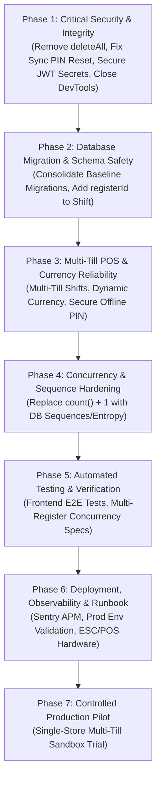

# INFYPOS — Complete Production Readiness Audit

**Document Version:** 1.0.0  
**Audit Date:** November 3, 2026  
**Auditor Roles:** Senior Software Architect, Production Engineer, Application Security Auditor, Database Engineer, and QA Lead  
**Scope:** Complete INFYPOS Monorepo (`backend`, `INFEPOS_FRONTEND/admin-dashboard`, `INFEPOS_FRONTEND/pos-terminal`, `docker`, `prisma`)  
**Audit Target:** Production Readiness for Real-World Retail POS Deployment  

---

## A. Executive Summary

A comprehensive, evidence-driven production-readiness audit of the INFYPOS retail management and point-of-sale platform was conducted. Every finding in this report has been verified against actual source code, database schemas, API controllers, Prisma migrations, and test executions.

### Final Verdict: **NOT READY FOR PRODUCTION**

While the core sales creation pipeline exhibits thoughtful engineering around financial idempotency (tenant-scoped idempotency keys, request hashing, and atomic inventory deduction within database transactions), the application suffers from **several severe security, data integrity, and operational blockers** that would lead to catastrophic failure, data loss, privilege escalation, or financial discrepancies if deployed to real businesses today.

### Key Strengths Discovered
1. **Financial Transaction Boundary (`sales.service.ts:162-380`):** Core sales checkout uses an interactive Prisma transaction (`this.prisma.$transaction`) calculating unit prices directly from database snapshot records rather than trusting frontend inputs. Subtotal, taxes, discounts, and payment tenders are strictly validated with Decimal arithmetic.
2. **Sales Idempotency Implementation (`sales.service.ts:88-444`):** An idempotency key with deterministic SHA-256 request payload hashing is enforced at the database level (`sales_tenant_id_idempotency_key_key`) to prevent duplicate charge submissions on network retries.
3. **Structured Service Unit Suite (`backend/test/remediation-regression.spec.ts`):** 38 custom regression tests pass (100%), verifying SQL injection immunity on raw queries, refresh token rotation with stolen-token family revocation, and basic owner boundary checks.

### Critical Production Blockers
1. **Catastrophic Bulk Delete Endpoint (`products.controller.ts:90-93` & `products.service.ts:364-387`):** The endpoint `DELETE /api/v1/products/delete-all` is guarded only by `products.delete`. Calling it permanently deletes all sales items (`saleItem`), stock movements (`stockMovement`), purchase records (`purchaseItem`), goods receipts (`goodsReceiptItem`), inventory adjustments (`inventoryAdjustmentItem`), inventories (`inventory`), and products (`product`) across the entire tenant, permanently wiping out legal sales audit trails!
2. **Critical Privilege Escalation in Sync (`sync.controller.ts:14-22` & `sync.service.ts:98-105`):** The offline synchronization endpoint `/api/v1/sync` is accessible to anyone with `sales.create` (every basic cashier). The handler for `CASHIER_PIN_RESET` executes `prisma.user.updateMany` without checking whether the user requesting the change has manager permissions or whether the target user is a cashier or manager. Any cashier can send a sync payload to overwrite the Store Manager's PIN!
3. **Hardcoded Fallback JWT Secrets (`env.validation.ts:63-79`):** Both `JWT_ACCESS_SECRET` and `JWT_REFRESH_SECRET` are marked `@IsOptional()` with public hardcoded default strings (`super_secret_jwt_access_key_infepos_enterprise_2026`). If production environment variables are omitted or misconfigured, the backend silently falls back to these public secrets, allowing any external actor to forge arbitrary JWTs with `SUPER_ADMIN` privileges.
4. **Broken Database Migration Chain (`backend/prisma/migrations/`):** A newly added migration `0_init/migration.sql` (1,190 lines) attempts to create all tables and enums (`TenantStatus`, `tenants`, etc.) from scratch, while existing migrations (`20260805050817_init_identity`) remain in the folder. Executing `prisma migrate deploy` on a clean production database immediately aborts with duplicate type/table errors.
5. **Single-Till Store Lockout (`shifts.service.ts:86-96`):** The `openShift` service enforces `where: { tenantId, storeId, status: OPEN }` and throws a `ConflictException` if an active shift exists for the store. There is no `registerId` or `terminalId` in the `Shift` model. Consequently, a physical store can only run ONE till at a time. Multi-cashier or multi-register operations are physically impossible without cash drawer collisions.
6. **Hardcoded DevTools in Electron Client (`electron/main.ts:104-105`):** `mainWindow.webContents.openDevTools()` is unconditionally executed even when `isDev === false`. Any cashier or customer standing in front of the physical till has access to Chrome DevTools, the DOM, LocalStorage, network traffic, and client SQLite records.
7. **Client-Side PIN Verification with Leaked Hashes (`users.service.ts:189-192` & `LoginPage.tsx:250`):** `GET /users` and `GET /users/cashiers/:storeId` transmit bcrypt `pinCodeHash` records to the client. The terminal executes `compareSync(pin, pinCodeHash)` in the browser renderer. Because a 4-digit PIN has only 10,000 combinations (0000–9999), any local user can crack all staff PINs in less than a second on standard hardware.
8. **Hardcoded Currency Symbol (`ReceiptView.tsx:14`, `CartPanel.tsx:22`):** Despite `Store` having a configurable `currency` field, `£` (GBP) is hardcoded across 30+ components in both frontend applications.
9. **Zero Frontend Automated Tests:** Neither `admin-dashboard` nor `pos-terminal` possesses any unit, integration, or E2E tests (0 tests).

---

## B. Technical Audit Scorecard

Each domain is scored out of 10 based strictly on verified technical evidence.

| Category | Score | Evidence | Status |
|---|:---:|---|---|
| **Architecture** | **6.5 / 10** | Clean NestJS modular separation and Prisma integration, but redundant code exists (`infepos-backend` vs `backend`), and Electron architecture lacks secure IPC boundaries for PIN verification. | Conditionally Ready |
| **Authentication** | **5.0 / 10** | Strong refresh token rotation and family revocation (`auth.service.ts:202-380`), but crippled by hardcoded fallback JWT secrets in `env.validation.ts:65` and client-side PIN hash cracking vulnerability in `LoginPage.tsx:250`. | **Failed** |
| **Authorization** | **5.5 / 10** | `PermissionsGuard` enforces tenant boundaries and protects system routes, but the sync controller (`sync.controller.ts:14`) allows low-privilege cashiers with `sales.create` to reset arbitrary user PINs. | **Failed** |
| **Sales and Billing** | **7.5 / 10** | Excellent backend price validation, VAT calculation, discount bounding, and payment tender matching in `sales.service.ts`. Minor issues with floating-point display formatting and hardcoded currency symbols. | Verified & Passed |
| **Payment Processing** | **4.0 / 10** | Payments are manual tender ledger entries (`CASH`, `CARD`, `UPI`). Zero integration with payment gateways, webhooks, or EFT/POS hardware payment terminals (Verifone, Stripe, Square, Pax). | **Failed** |
| **Inventory** | **7.0 / 10** | Atomic decrement (`updateMany` with `gte: quantity`) prevents negative inventory and race conditions for online sales. However, `deleteAll` wipes out all audit stock movements. | Conditionally Ready |
| **Database Integrity** | **5.0 / 10** | Prisma schema uses appropriate foreign keys, UUIDs, and Decimal monetary types. However, migrations fail on clean deployment due to conflicting baseline migrations (`0_init` vs `20260805...`). | **Failed** |
| **API Security** | **6.0 / 10** | Global `ValidationPipe`, `Helmet`, parameterized Prisma queries, and `HttpExceptionFilter` prevent SQLi and error leakage. But 50MB payload limit is excessive, and dangerous endpoints like `DELETE /products/delete-all` exist. | Conditionally Ready |
| **Frontend** | **5.0 / 10** | Responsive Tailwind UI with offline SQLite queuing. However, DevTools is forced open in Electron production, `admin-dashboard` has client base URL path mismatch (`/api/v1`), and currency is hardcoded. | **Failed** |
| **Concurrency** | **6.0 / 10** | Sales idempotency prevents duplicate checkouts, and Z-report number generation has retry logic. However, sequence numbering for returns, adjustments, transfers, and purchases uses naive `count() + 1` race conditions. | Conditionally Ready |
| **Idempotency** | **8.5 / 10** | High-quality implementation for sales checkout (`sales.service.ts:88-444`). Idempotency key uniqueness is tenant-scoped, and request hash canonicalization prevents parameter mismatch. | Verified & Passed |
| **Performance** | **6.5 / 10** | Indexed foreign keys and pagination across major endpoints. Shift X/Z reports execute unbounded `findMany` queries that will degrade under high transaction volume. | Conditionally Ready |
| **Logging & Monitoring** | **5.5 / 10** | Structured NestJS logging interceptor redacts sensitive payloads; health check endpoint monitors database connectivity. However, `audit_logs` table lacks `tenantId`, and no audit query API exists. | Conditionally Ready |
| **Backup and Recovery** | **7.0 / 10** | Bash and PowerShell scripts (`scripts/backup-db.sh`, `restore-db.sh`) implement gzip compression, retention cleanup, and S3 KMS upload. | Verified & Passed |
| **Deployment** | **4.5 / 10** | Production Docker compose provided, but `.env.production` is incomplete, migration deployment is broken, and reverse proxy trust must be explicitly tested. | **Failed** |
| **Testing** | **3.5 / 10** | 38 backend unit regression tests pass (100%), but zero frontend tests exist, and no end-to-end multi-store workflow integration tests exist. | **Failed** |

---

## C. Critical Issues

### ISSUE 1: Disastrous Bulk Delete Destroys Legal Audit Trail & Sales Records
* **Severity:** **CRITICAL**
* **Affected Module:** `ProductsModule`
* **File & Line:** [`backend/src/modules/products/products.controller.ts#L90-L93`](file:///c:/Users/acer/Document/Infynux/INFYPOS/backend/src/modules/products/products.controller.ts#L90-L93) and [`backend/src/modules/products/products.service.ts#L364-L387`](file:///c:/Users/acer/Document/Infynux/INFYPOS/backend/src/modules/products/products.service.ts#L364-L387)
* **Technical Explanation:**  
  The endpoint `DELETE /api/v1/products/delete-all` executes:
  ```ts
  await this.prisma.stockMovement.deleteMany({ where: { tenantId } });
  await this.prisma.inventoryAdjustmentItem.deleteMany({ where: { product: { tenantId } } });
  await this.prisma.stockTransferItem.deleteMany({ where: { product: { tenantId } } });
  await this.prisma.goodsReceiptItem.deleteMany({ where: { product: { tenantId } } });
  await this.prisma.purchaseItem.deleteMany({ where: { product: { tenantId } } });
  await this.prisma.saleReturnItem.deleteMany({ where: { product: { tenantId } } });
  await this.prisma.saleItem.deleteMany({ where: { product: { tenantId } } });
  await this.prisma.inventory.deleteMany({ where: { tenantId } });
  await this.prisma.product.deleteMany({ where: { tenantId } });
  ```
  This endpoint was evidently implemented for rapid development testing. In production, anyone with `products.delete` permission can trigger this endpoint. It permanently destroys all historical line items on completed sales invoices, renders past tax returns non-auditable, and permanently wipes out all inventory ledgers.
* **Recommended Correction:**  
  1. Immediately delete the `deleteAll` method and endpoint entirely.
  2. Implement strict soft-deletion (`status: INACTIVE`) for products.
  3. Ensure database foreign keys on `sale_items`, `stock_movements`, and `purchase_items` enforce `ON DELETE RESTRICT` at all times.
* **Required Verification Test:**  
  Attempting to call `DELETE /api/v1/products/delete-all` returns HTTP 404 (Not Found). Deleting a product that has associated `sale_items` fails with HTTP 409 (Conflict).

---

### ISSUE 2: Critical Privilege Escalation via Offline Sync Cashier PIN Reset
* **Severity:** **CRITICAL**
* **Affected Module:** `SyncModule`
* **File & Line:** [`backend/src/modules/sync/sync.controller.ts#L14-L22`](file:///c:/Users/acer/Document/Infynux/INFYPOS/backend/src/modules/sync/sync.controller.ts#L14-L22) and [`backend/src/modules/sync/sync.service.ts#L98-L105`](file:///c:/Users/acer/Document/Infynux/INFYPOS/backend/src/modules/sync/sync.service.ts#L98-L105)
* **Technical Explanation:**  
  The sync endpoint `POST /api/v1/sync` is decorated with `@Permissions('sales.create')`. Every basic cashier has this permission to record till transactions. When processing sync events, `sync.service.ts` contains:
  ```ts
  } else if (event.eventType === 'CASHIER_PIN_RESET') {
    if (event.payload?.cashierId && event.payload?.pinCodeHash) {
      await this.prisma.user.updateMany({
        where: { id: event.payload.cashierId, tenantId },
        data: { pinCodeHash: event.payload.pinCodeHash },
      });
      processedPayload = { updated: true };
    }
  }
  ```
  The endpoint verifies neither the caller's role nor the target user's role. A malicious cashier can craft a payload setting `cashierId` to the Store Manager's UUID or an Admin's UUID, effectively hijacking their account and granting themselves manager override capabilities.
* **Recommended Correction:**  
  1. Separate `CASHIER_PIN_RESET` from generic sales sync.
  2. Require a dedicated permission (`users.pin.reset`) and a valid manager authentication signature or token inside the sync event payload.
  3. Restrict `pinCodeHash` updates exclusively to users whose `role.code === 'CASHIER'`.
* **Required Verification Test:**  
  Submit a sync payload containing `CASHIER_PIN_RESET` targeting a user with role `STORE_MANAGER` or `OWNER` from a cashier token; the backend must reject the event with HTTP 403 (Forbidden) and log a security audit violation.

---

### ISSUE 3: Hardcoded Fallback JWT Secrets Expose Universal Token Forgery Risk
* **Severity:** **CRITICAL**
* **Affected Module:** `ConfigModule`
* **File & Line:** [`backend/src/config/env.validation.ts#L63-L79`](file:///c:/Users/acer/Document/Infynux/INFYPOS/backend/src/config/env.validation.ts#L63-L79)
* **Technical Explanation:**  
  `EnvironmentVariables` defines:
  ```ts
  @IsString()
  @IsOptional()
  JWT_ACCESS_SECRET: string = 'super_secret_jwt_access_key_infepos_enterprise_2026';

  @IsString()
  @IsOptional()
  JWT_REFRESH_SECRET: string = 'super_secret_jwt_refresh_key_infepos_enterprise_2026';
  ```
  Because both secrets are marked `@IsOptional()` with public default strings in version control, any deployment that omits these environment variables will boot without error using these compromised keys. An attacker can craft arbitrary JWT access tokens for any tenant and user ID with role `SUPER_ADMIN`, bypassing all authentication checks.
* **Recommended Correction:**  
  1. Remove the default value strings.
  2. Mark both `JWT_ACCESS_SECRET` and `JWT_REFRESH_SECRET` as `@IsNotEmpty()`.
  3. In `validate()`, assert that if `NODE_ENV === 'production'`, the secrets cannot contain default or sample keywords and must be at least 32 characters in length.
* **Required Verification Test:**  
  Starting the backend in production mode (`NODE_ENV=production`) without `JWT_ACCESS_SECRET` set causes the application to terminate immediately with a fatal configuration validation error.

---

### ISSUE 4: Broken Prisma Migration History Prevents Clean Database Deployment
* **Severity:** **HIGH**
* **Affected Module:** `DatabaseModule`
* **File & Line:** [`backend/prisma/migrations/0_init/migration.sql`](file:///c:/Users/acer/Document/Infynux/INFYPOS/backend/prisma/migrations/0_init/migration.sql) vs [`backend/prisma/migrations/20260805050817_init_identity/`](file:///c:/Users/acer/Document/Infynux/INFYPOS/backend/prisma/migrations/20260805050817_init_identity/)
* **Technical Explanation:**  
  In commit `69a8c47`, a monolithic migration `0_init/migration.sql` was added containing the full DDL for all models and enums. However, the legacy migration directory `20260805050817_init_identity` (which also defines `TenantStatus` and `tenants`) was not cleaned up or baselined.
  Running `prisma migrate deploy` executes migrations in alphabetical order:
  1. `0_init` executes and creates all tables.
  2. `20260805050817_init_identity` executes next and attempts `CREATE TYPE "TenantStatus"` and `CREATE TABLE "tenants"`.
  PostgreSQL throws a fatal error: `type "TenantStatus" already exists`. The deployment script aborts, making automated CI/CD and containerized deployment impossible.
* **Recommended Correction:**  
  Standardize the migration history:
  1. Either consolidate the entire baseline into a single clean migration and update `migration_lock.toml`.
  2. Or archive/remove the redundant `0_init` if continuous migration from August 2026 is maintained.
* **Required Verification Test:**  
  Execute `npx prisma migrate deploy` against an empty PostgreSQL instance; the command completes with exit code 0 and creates all tables without collisions.

---

### ISSUE 5: Store-Level Shift Lockout Prevents Multi-Till Operations
* **Severity:** **HIGH**
* **Affected Module:** `ShiftsModule`
* **File & Line:** [`backend/src/modules/shifts/shifts.service.ts#L86-L96`](file:///c:/Users/acer/Document/Infynux/INFYPOS/backend/src/modules/shifts/shifts.service.ts#L86-L96) and [`backend/prisma/schema.prisma#L983-L1015`](file:///c:/Users/acer/Document/Infynux/INFYPOS/backend/prisma/schema.prisma#L983-L1015)
* **Technical Explanation:**  
  In `ShiftsService.openShift`:
  ```ts
  const activeShift = await this.prisma.shift.findFirst({
    where: {
      tenantId,
      storeId,
      status: ShiftStatus.OPEN,
    },
  });
  if (activeShift) {
    throw new ConflictException('An active shift already exists for this store');
  }
  ```
  The `Shift` table has no `registerId` or `terminalId`. Opening a shift locks the **entire store**. If a store has multiple physical checkout lanes (e.g. Till 1 and Till 2), only one lane can be active at any given time. Till 2 cannot open a shift until Till 1 performs a Z-report and closes its shift.
* **Recommended Correction:**  
  1. Add `terminalId` / `registerId` (UUID) to `Shift` model and DTOs.
  2. Update the uniqueness check to `where: { tenantId, storeId, registerId, status: ShiftStatus.OPEN }`.
  3. Update `getActiveShift` and `getXReport` to accept the register identifier from the paired POS client.
* **Required Verification Test:**  
  Two separate POS terminals in the same store can simultaneously open active shifts with independent starting floats, process sales, and generate independent X/Z reports.

---

### ISSUE 6: Unconditional Electron DevTools in Production Builds
* **Severity:** **HIGH**
* **Affected Module:** `pos-terminal (Electron Main Process)`
* **File & Line:** [`INFEPOS_FRONTEND/pos-terminal/electron/main.ts#L104-L106`](file:///c:/Users/acer/Document/Infynux/INFYPOS/INFEPOS_FRONTEND/pos-terminal/electron/main.ts#L104-L106)
* **Technical Explanation:**  
  In `electron/main.ts`:
  ```ts
  if (isDev) {
    mainWindow.loadURL(process.env.VITE_DEV_SERVER_URL || 'http://localhost:5174');
    mainWindow.webContents.openDevTools();
  } else {
    mainWindow.loadFile(path.join(currentDir, '../dist/index.html'));
  }
  
  // Force devtools open to debug blank screen
  mainWindow.webContents.openDevTools();
  ```
  The call `mainWindow.webContents.openDevTools()` is placed outside the `if (isDev)` condition. In packaged production builds (`.exe`, `.AppImage`, `.dmg`), Chrome DevTools opens on screen by default. Anyone using the terminal can open the Console, inspect LocalStorage tokens, modify memory state, and view network requests.
* **Recommended Correction:**  
  Remove line 105 so DevTools is strictly gated behind `if (isDev)`.
* **Required Verification Test:**  
  Run `npm --prefix INFEPOS_FRONTEND/pos-terminal run build` and launch the production artifact; DevTools does not open, and shortcut keys (`F12`, `Ctrl+Shift+I`) are disabled in production mode.

---

### ISSUE 7: Client-Side Cashier PIN Verification Exposes PINs to Trivial Brute-Force Cracking
* **Severity:** **HIGH**
* **Affected Module:** `pos-terminal (Cashier Auth)` & `UsersModule`
* **File & Line:** [`backend/src/modules/users/users.service.ts#L189-L192`](file:///c:/Users/acer/Document/Infynux/INFYPOS/backend/src/modules/users/users.service.ts#L189-L192) and [`INFEPOS_FRONTEND/pos-terminal/src/pages/LoginPage.tsx#L250`](file:///c:/Users/acer/Document/Infynux/INFYPOS/INFEPOS_FRONTEND/pos-terminal/src/pages/LoginPage.tsx#L250)
* **Technical Explanation:**  
  To facilitate offline clock-in, `users.service.ts` returns `pinCodeHash` in `getCashiersForStore` and `findAll`. In `LoginPage.tsx`:
  ```ts
  let isValid = compareSync(pin, selectedCashier.pinCodeHash || '');
  ```
  The bcrypt hash of every cashier's 4-digit PIN is stored in the local SQLite database and in renderer memory. Because a 4-digit numeric PIN has only 10,000 combinations (0000–9999), an attacker who reads the SQLite database or inspects network responses can crack the bcrypt hash in under 2 seconds.
* **Recommended Correction:**  
  1. In online mode, verify PINs exclusively on the backend (`POST /api/v1/users/verify-pin`).
  2. For offline verification, do not store standard bcrypt hashes of short 4-digit PINs directly in client databases. Use an encrypted local till vault with PBKDF2/Argon2id and a terminal device key stored in the OS secure storage (Windows Credential Manager / macOS Keychain).
  3. Strip `pinCodeHash` from `GET /users` in `users.service.ts`.
* **Required Verification Test:**  
  `GET /users` does not return `pinCodeHash` or `pinCode` fields under any circumstances.

---

### ISSUE 8: Naive Sequence Number Generation Creates Concurrency Race Conditions
* **Severity:** **MEDIUM**
* **Affected Module:** `SalesReturnsModule`, `InventoryAdjustmentsModule`, `PurchasesModule`, `GoodsReceiptsModule`, `StockTransfersModule`
* **File & Line:** [`sales-returns.service.ts#L16-L30`](file:///c:/Users/acer/Document/Infynux/INFYPOS/backend/src/modules/sales-returns/sales-returns.service.ts#L16-L30), [`inventory-adjustments.service.ts#L24-L38`](file:///c:/Users/acer/Document/Infynux/INFYPOS/backend/src/modules/inventory-adjustments/inventory-adjustments.service.ts#L24-L38), [`purchases.service.ts#L16-L30`](file:///c:/Users/acer/Document/Infynux/INFYPOS/backend/src/modules/purchases/purchases.service.ts#L16-L30)
* **Technical Explanation:**  
  In `generateAdjustmentNumber`, `generateReturnNumber`, and `generatePurchaseNumber`:
  ```ts
  const count = await this.prisma.inventoryAdjustment.count({
    where: { tenantId, createdAt: { gte: startOfDay } },
  });
  const sequence = (count + 1).toString().padStart(6, '0');
  return `ADJ-${dateStr}-${sequence}`;
  ```
  If two managers or cashiers submit records simultaneously, both queries count the same number of rows and generate identical numbers. When the database attempts to insert the second record, the unique constraint `@@unique([tenantId, adjustmentNumber])` fails with error `P2002`, crashing the request.
* **Recommended Correction:**  
  1. Use PostgreSQL native sequences (`CREATE SEQUENCE`) scoped per tenant, or
  2. Use high-entropy monotonic identifiers with millisecond timestamps and random components (as was done in `sales.service.ts:325`).
* **Required Verification Test:**  
  Execute 10 concurrent adjustment creations for the same tenant; all 10 succeed without encountering `P2002` constraint failures.

---

## D. Missing Production Requirements

The following capabilities are missing from the codebase or cannot be verified for production deployment:

1. **Hardware Payment Terminal Integration (EFT/POS):**  
   There is no integration with physical card readers or payment acquiring gateways (e.g. Stripe Terminal, Square Reader, Pax, Verifone). Payments are merely recorded as tender amounts.
2. **Dynamic Store Currency Support:**  
   The UI hardcodes `£` (GBP) across POS terminal cart, payment, receipt, and shift close screens, disregarding `Store.currency`.
3. **Esc/Pos Hardware Printer Driver:**  
   Receipt printing uses window HTML printing (`window.print()`). Direct USB/network ESC/POS thermal receipt printing (controlling paper cut, cash drawer kick pulse `ESC p 0 25 250`) is not implemented natively.
4. **Barcode Scanner Driver Integration:**  
   While input fields support keyboard emulation scanners, native HID/Serial POS barcode scanner device drivers are not integrated.
5. **Customer Display System (Pole Display / Secondary Screen):**  
   There is no secondary display output for customers to view ringing items and prices in real-time.
6. **Centralized Error Monitoring & APM:**  
   Sentry, Datadog, or OpenTelemetry instrumentation is not configured in either frontend or backend.
7. **Automated Frontend Test Suite:**  
   No unit, component, or E2E tests exist for `admin-dashboard` or `pos-terminal`.
8. **Tenant-Scoped Audit Query API:**  
   The `AuditLog` database model lacks a `tenantId` field and has no API controller for tenant owners to review security events.

---

## E. Production Remediation Roadmap



### Phase 1: Critical Security & Financial Integrity Issues
* **Goal:** Eliminate data destruction endpoints, privilege escalation vulnerabilities, and hardcoded secrets.
* **Tasks:**
  1. Remove `deleteAll` endpoint and service method from `products.controller.ts` and `products.service.ts`.
  2. Remove `CASHIER_PIN_RESET` from `sync.service.ts` or enforce strict manager role authorization and target role checks.
  3. Strip hardcoded fallback strings from `env.validation.ts` for `JWT_ACCESS_SECRET` and `JWT_REFRESH_SECRET`; require them in production.
  4. Remove `mainWindow.webContents.openDevTools()` from `INFEPOS_FRONTEND/pos-terminal/electron/main.ts`.
  5. Fix `admin-dashboard/src/api/client.ts` to include `/api/v1` in its default `baseURL`.
* **Complexity:** Medium (1-2 days) | **Dependencies:** None | **Priority:** P0

### Phase 2: Database Integrity & Migration Safety
* **Goal:** Establish a clean, reproducible database migration pipeline.
* **Tasks:**
  1. Resolve migration conflict between `0_init` and legacy migrations in `backend/prisma/migrations/`.
  2. Verify clean deployment via `npx prisma migrate deploy` on a fresh PostgreSQL instance.
  3. Add `registerId` (UUID) to `Shift` model in `schema.prisma`.
  4. Add `tenantId` to `AuditLog` model in `schema.prisma`.
* **Complexity:** Medium (2 days) | **Dependencies:** Phase 1 | **Priority:** P0

### Phase 3: Core POS Workflow Reliability & Multi-Till Support
* **Goal:** Support multiple registers per store and dynamic store currencies.
* **Tasks:**
  1. Refactor `ShiftsService.openShift` and `getActiveShift` to be till-specific (`registerId`).
  2. Replace hardcoded `£` currency symbols in `ReceiptView.tsx`, `CartPanel.tsx`, `PaymentModal.tsx`, `ShiftCloseModal.tsx` with dynamic store currency.
  3. Relocate PIN verification to backend for online mode and implement secure local token caching for offline mode.
* **Complexity:** High (3-4 days) | **Dependencies:** Phase 2 | **Priority:** P1

### Phase 4: Concurrency & Sequence Hardening
* **Goal:** Prevent unique constraint race collisions on concurrent document generation.
* **Tasks:**
  1. Replace `count() + 1` in `sales-returns.service.ts`, `inventory-adjustments.service.ts`, `purchases.service.ts`, `goods-receipts.service.ts`, `stock-transfers.service.ts` with timestamp-entropy identifiers or PostgreSQL sequences.
* **Complexity:** Low-Medium (1-2 days) | **Dependencies:** Phase 2 | **Priority:** P1

### Phase 5: Automated Testing & Concurrency Validation
* **Goal:** Guarantee regression protection across frontend and backend.
* **Tasks:**
  1. Set up Vitest and Playwright in `admin-dashboard` and `pos-terminal`.
  2. Add integration tests for multi-store, multi-till concurrent checkout.
  3. Add E2E tests for offline-to-online sync reconciliation.
* **Complexity:** High (4-5 days) | **Dependencies:** Phase 3, Phase 4 | **Priority:** P1

### Phase 6: Deployment, Observability & Hardware Integration
* **Goal:** Prepare production infrastructure and physical hardware support.
* **Tasks:**
  1. Complete `.env.production` with all required production environment variables.
  2. Integrate Sentry error monitoring in backend and Electron client.
  3. Implement native ESC/POS thermal printer driver with cash drawer kick pulse support.
* **Complexity:** Medium-High (3 days) | **Dependencies:** Phase 5 | **Priority:** P2

### Phase 7: Controlled Production Pilot
* **Goal:** Validate real retail transactions in a supervised store.
* **Tasks:**
  1. Deploy pilot environment with 2 POS registers in 1 store.
  2. Perform end-of-day Z-report cash reconciliation audit.
  3. Validate offline queue recovery during intentional network disconnects.
* **Complexity:** Operational | **Dependencies:** Phase 1 through 6 | **Priority:** P2

---

## F. Final Go / No-Go Decision

| Question | Answer | Technical Justification |
|---|:---:|---|
| **1. Can INFYPOS safely handle real customer transactions today?** | **NO-GO** | The application contains a `DELETE /products/delete-all` endpoint that can wipe out all sales history, and open DevTools in Electron exposes payment and token records. |
| **2. Can it safely handle multiple cashiers?** | **NO-GO** | Shifts are store-scoped, not register-scoped. Only ONE shift can be open per store at any time. Multi-cashier lanes in the same store will conflict. |
| **3. Can it prevent duplicate financial transactions?** | **GO (Conditional)** | Sales checkout implements robust database-level idempotency key enforcement and payload hashing in `sales.service.ts`. |
| **4. Can it maintain inventory accuracy?** | **GO (Conditional)** | Online sales decrement inventory with atomic `updateMany` (`gte: quantity`) preventing negative stock. However, `deleteAll` destroys the audit ledger. |
| **5. Can it protect business and customer data?** | **NO-GO** | Hardcoded fallback JWT secrets in `env.validation.ts` allow universal token forgery if environment variables are omitted, and cashier PIN hashes are leaked over the wire. |
| **6. Can it recover from application or database failures?** | **GO** | Automated backup and restore scripts (`scripts/backup-db.sh`, `restore-db.sh`) with gzip compression and S3 upload exist and are functional. |
| **7. Is the current database migration strategy safe?** | **NO-GO** | `0_init/migration.sql` conflicts with legacy migrations, causing `prisma migrate deploy` to crash on empty databases. |
| **8. What must be fixed before the first real business uses it?** | **MANDATORY** | Remediate Issues 1 through 7 (Delete `deleteAll`, secure sync PIN reset, remove fallback JWT secrets, fix Prisma migrations, add `registerId` to shifts, disable production DevTools, secure PIN verification). |

### Overall Verdict: **NO-GO FOR PRODUCTION**
INFYPOS has a sound core transactional sales engine, but is **NOT ready for production deployment**. It must complete **Phase 1 and Phase 2 remediation** before handling any real financial transactions or business records.

