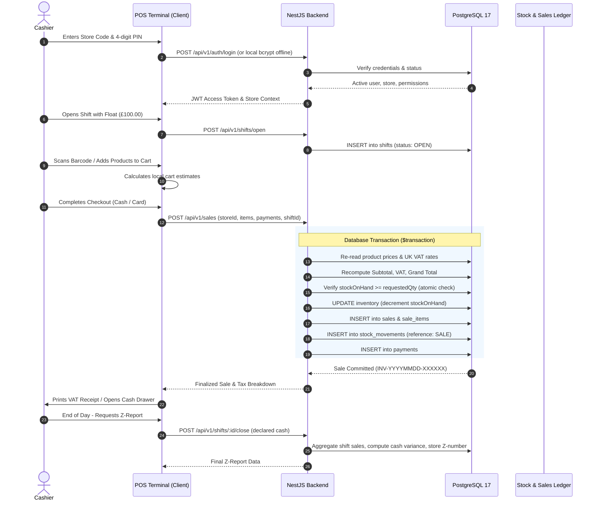

# INFYPOS Critical Business Workflows Audit

**Document Version:** 1.0.0  
**Audit Date:** 2026-10-12  
**Audit Scope:** End-to-End Retail Operations, Data Consistency, Race Conditions & Failure Modes  

---

## 1. Primary Retail Store Workflow Map



---

## 2. Step-by-Step Workflow Analysis

### Step 1: Authentication & Session Establishment
- **Observed Behavior:** User authenticates via `/api/v1/auth/login` with `tenantCode`, `email`, and `password`. Returns JWT `accessToken` (15m expiry) and `refreshToken` (7d).
- **Vulnerabilities / Edge Cases:**
  - Token refresh does NOT rotate or invalidate the refresh token (`AuthService.refresh`).
  - Terminal cashier PIN authentication downloads bcrypt hashes to client local SQLite (`/users/cashiers/:storeId`).

### Step 2: Resource & Multi-Store Scope Restriction
- **Observed Behavior:** Tenant isolation is enforced across store queries (`where: { tenantId }`).
- **Defects:**
  - `TenantsController` has no tenant ID filter, allowing merchant owners to view and edit other business tenants.

### Step 3 & 4: Product Catalog Retrieval & Barcode Lookup
- **Observed Behavior:** Products retrieved via `/api/v1/products` filtering by status `ACTIVE` and tenant ID. Barcode scanner buffer hook (`useBarcodeScanner.ts`) listens to keystroke bursts (<50ms) to detect USB scanners.

### Step 5: Tax, Discount & Total Calculation
- **Observed Behavior:** Server recalculates cart totals:
  `lineTotal = product.sellingPrice * qty`  
  `lineTax = lineTotal * (product.vatRate / 100)`  
  `subtotal = sum(lineTotal)`  
  `taxAmount = sum(lineTax)`  
- **Vulnerabilities / Edge Cases:**
  - `dto.discountAmount` is subtracted without boundary validation. Server does not enforce `discountAmount <= subtotal` or prevent negative grand totals!

### Step 6 & 7: Checkout Completion & Atomic Inventory Deductions
- **Observed Behavior:** Handled inside `this.prisma.$transaction`. Stock deduction uses atomic conditional SQL update:
  ```typescript
  await tx.inventory.updateMany({
    where: { id: inventory.id, quantityOnHand: { gte: quantity } },
    data: { quantityOnHand: { decrement: quantity } }
  });
  ```
  If `updateResult.count === 0`, it throws `ConflictException('Race condition detected or insufficient stock')`.
- **Integrity Result:** PASS. Prevents concurrent overselling and protects inventory consistency.

### Step 8: Receipt Generation
- **Observed Behavior:** `ReceiptView.tsx` renders business header, VAT registration number, store address, line items with VAT indicators (Standard 20%, Reduced 5%, Zero 0%), payment tender method, and change due.

### Step 9: Shift Reconciliation & Reports Integration
- **Observed Behavior:** Completed sales immediately appear in `/api/v1/reports/dashboard` and shift interim X-Reports. When closing shift, `ShiftsService.closeShift` computes expected cash = `startingFloat + cashSales - cashReturns`, calculates variance against declared cash, and persists immutable Z-Report numbers.

### Step 10: Returns & Refunds
- **Observed Behavior:** `SalesReturnsService.create` validates returned quantity against `soldQuantity - returnedQuantity`. It restores inventory atomically, generates `StockMovement` with type `SALE_RETURN`, and apportions invoice discounts proportionately.

### Step 11: Concurrency & Duplicate Submissions
- **Observed Behavior:** Offline synchronization sends idempotent event IDs stored in `SyncEvent` (`tenantId_eventId` compound unique constraint). Duplicate deliveries are recognized and skipped with status `ALREADY_PROCESSED`.
- **Defect:** POS web frontend checkout button does not disable synchronously on click, risking rapid double-tap requests before server response.

### Step 12: Restricted Action Access
- **Observed Behavior:** Cashier role attempting to access `reports.read`, `inventory.update`, or `roles.create` is rejected by `PermissionsGuard` with HTTP 403 Forbidden.
