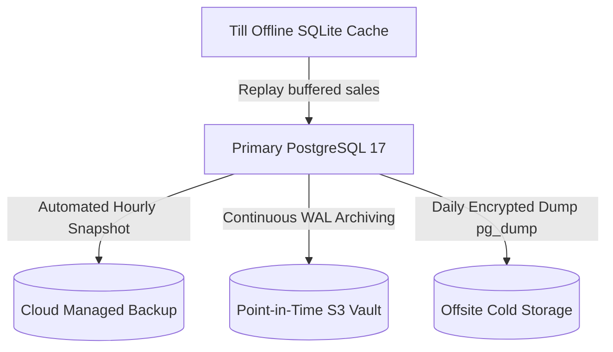

# INFYPOS Backup, Restore & Disaster Recovery Strategy

**Document Version:** 1.0.0  
**Audit Date:** 2026-10-12  
**Target Compliance:** Retail Business Continuity, Fiscal Accounting, Data Loss Prevention  

---

## 1. Objectives & Metrics

- **Recovery Point Objective (RPO):** Maximum 15 minutes of transaction data loss.
  - *Local Till Buffer:* Because offline tills persist sales in local SQLite (`pos-terminal`), any till sales executed during a primary database outage will buffer locally and re-sync via `POST /api/v1/sync` once database connectivity is restored, effectively reducing store sales RPO to 0 minutes for offline tills.
- **Recovery Time Objective (RTO):** Maximum 30 minutes to restore complete API and database availability.

---

## 2. Backup Architecture & Policy



### 2.1 Backup Cadence
1. **Continuous WAL Archiving:** Point-in-time recovery (PITR) with continuous Write-Ahead Log (WAL) streaming.
2. **Daily Logical Dumps:** Compressed, encrypted `pg_dump` exported daily at 02:00 UTC.
3. **Retention Policy:**
   - Hourly PITR: 7 days.
   - Daily Snapshots: 30 days.
   - Monthly Financial Ledgers: 7 years (statutory tax compliance).

### 2.2 Backup Command Script (`scripts/backup-db.sh`)
```bash
#!/bin/bash
set -euo pipefail

TIMESTAMP=$(date +"%Y%m%d_%H%M%S")
BACKUP_DIR="/var/backups/infypos"
BACKUP_FILE="${BACKUP_DIR}/infypos_backup_${TIMESTAMP}.sql.gz"

mkdir -p "${BACKUP_DIR}"

echo "Starting encrypted database dump..."
pg_dump -h "${DB_HOST}" -U "${DB_USER}" -d "${DB_NAME}" --no-owner --no-privileges | gzip -9 > "${BACKUP_FILE}"

# Encrypt with GPG or AWS KMS if streaming offsite
echo "Uploading backup to isolated S3 backup vault..."
aws s3 cp "${BACKUP_FILE}" "s3://${BACKUP_S3_BUCKET}/db-backups/infypos_backup_${TIMESTAMP}.sql.gz" --sse aws:kms

echo "Backup completed successfully: ${BACKUP_FILE}"
```

---

## 3. Step-by-Step Restoration Procedure

> [!CAUTION]
> Never restore directly over a live active production database. Always restore into an isolated staging database first, verify data integrity, and update connection strings.

### Step 1: Provision Isolated Target Database
```bash
# Example Docker or managed DB target
createdb -h localhost -U postgres infypos_restore_test
```

### Step 2: Stream Backup to Target
```bash
gunzip -c infypos_backup_20261012_040000.sql.gz | psql -h localhost -U postgres -d infypos_restore_test
```

### Step 3: Run Data Consistency & Integrity Audit
Execute SQL consistency checks against restored database:
```sql
-- 1. Check total completed sales count
SELECT COUNT(*) FROM sales WHERE status = 'COMPLETED';

-- 2. Verify stock movements reconcile with inventory on hand
SELECT i.id, i.product_id, i.quantity_on_hand,
       COALESCE(SUM(sm.quantity), 0) as calculated_movement
FROM inventories i
LEFT JOIN stock_movements sm ON sm.inventory_id = i.id
GROUP BY i.id, i.product_id, i.quantity_on_hand;

-- 3. Verify shift cash balances
SELECT id, starting_float, declared_cash, expected_cash, variance
FROM shifts
WHERE status = 'CLOSED'
ORDER BY closed_at DESC LIMIT 10;
```

### Step 4: Reconcile Buffered Till Transactions
Once the database is verified, terminal devices automatically trigger sync via `useSyncManager.ts`. Any uncommitted sales in SQLite `sales_queue` are transmitted to `/api/v1/sync` and idempotently recorded via `SyncEvent` deduplication.
