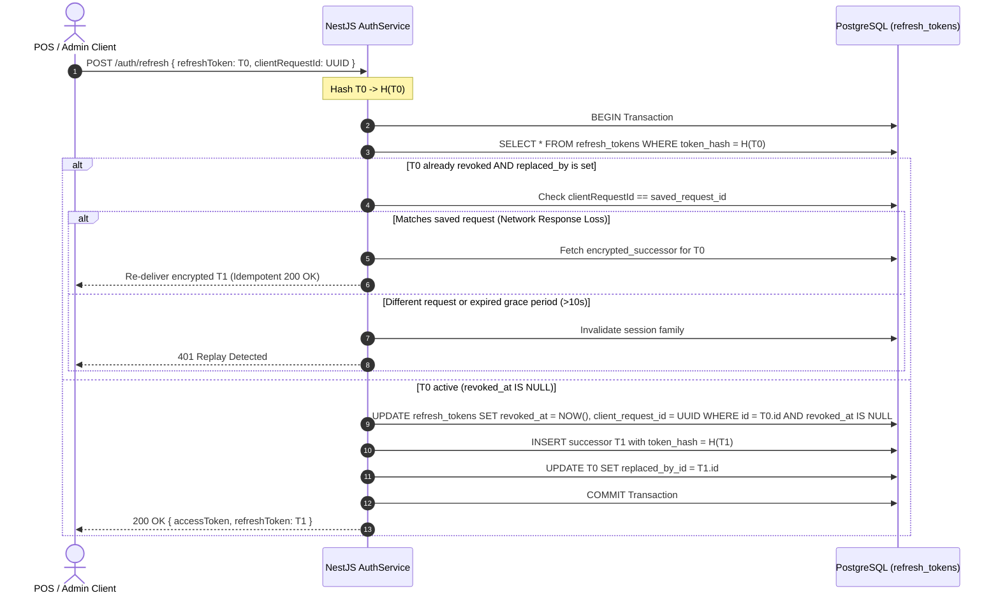
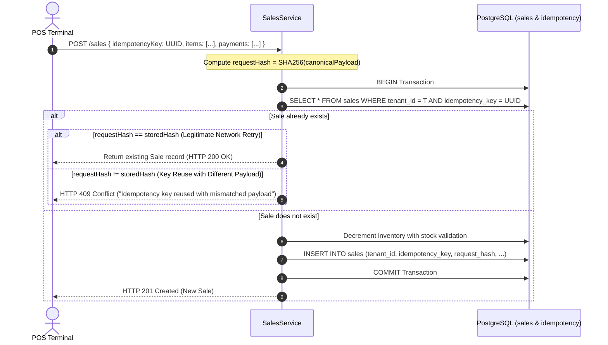

# INFYPOS — Phase 1 Residual Risk Review & Production Pre-Flight Audit

**Document ID:** `docs/production-readiness/13-phase1-residual-risk-review.md`  
**Date:** 2026-10-12  
**Auditor:** Principal Software Architect, Senior Security Engineer, Production Readiness Reviewer  
**Scope:** Source-level residual risk review following Phase 1 security corrections and pre-Phase 2 risk analysis  
**Target Codebase:** INFYPOS Active Production Monorepo (`backend/`, `INFEPOS_FRONTEND/admin-dashboard`, `INFEPOS_FRONTEND/pos-terminal`)  
**Overall Readiness Verdict:** **Phase 1 complete with documented residual risks; Phase 2 blocked pending migration planning and infrastructure verification.**

---

## 1. Confirmed Findings from Source Inspection

### 1.1 Refresh-Token Security & Recovery Protocol Gaps
* **Source Files Inspected:**
  * [`backend/src/modules/auth/auth.service.ts`](file:///c:/Users/acer/Document/Infynux/INFYPOS/backend/src/modules/auth/auth.service.ts#L149-L276)
  * [`backend/prisma/schema.prisma`](file:///c:/Users/acer/Document/Infynux/INFYPOS/backend/prisma/schema.prisma#L175-L193) (`RefreshToken` model)
  * [`INFEPOS_FRONTEND/pos-terminal/src/api/client.ts`](file:///c:/Users/acer/Document/Infynux/INFYPOS/INFEPOS_FRONTEND/pos-terminal/src/api/client.ts#L41-L95)
  * [`INFEPOS_FRONTEND/admin-dashboard/src/api/client.ts`](file:///c:/Users/acer/Document/Infynux/INFYPOS/INFEPOS_FRONTEND/admin-dashboard/src/api/client.ts#L23-L34)

#### Detailed Technical Findings
1. **Single-Successor Invariant is Upheld**:
   The conditional atomic CAS update in `auth.service.ts:203–218`:
   ```typescript
   const updateResult = await tx.refreshToken.updateMany({
     where: { id: matchedToken.id, revokedAt: null },
     data: { revokedAt: new Date() },
   });
   if (updateResult.count === 0) throw new UnauthorizedException(...);
   ```
   guarantees that **a single refresh token can never issue more than one active successor token**. In PostgreSQL, the row lock on `updateMany` serializes concurrent consumers; exactly one transaction receives `count = 1`.
2. **Response Loss Causes Permanent Client Disconnection**:
   If the database transaction commits $T_0 \to T_1$ rotation, but the network connection drops before the HTTP response reaches the client, the client retains only $T_0$.
   * If the client retries within 5000ms: Rejected with `UnauthorizedException('Refresh token was consumed by a concurrent request.')`. The client is **not** given $T_1$, nor can it obtain any new token.
   * If the client retries after 5000ms: The backend executes `updateMany({ where: { userId, revokedAt: null }, data: { revokedAt: new Date() } })`, invalidating all active sessions for the user across all devices.
   * *Conclusion*: **The current design has no mechanism to recover from an in-flight network response loss.**
3. **The Five-Second Replay Heuristic is Unreliable**:
   * *False Positive*: Mobile POS terminals switching between Wi-Fi and LTE or experiencing high network jitter may take >5000ms to retry, resulting in catastrophic family revocation for a legitimate store cashier.
   * *False Negative*: An attacker who intercepts a refresh token over an unencrypted local network or via compromised client telemetry can replay it within 5000ms. The backend misclassifies the theft as a "concurrent retry", returns 401 without family revocation, and allows the attacker's activity to go undetected.
4. **Admin Dashboard Discards Refresh Tokens on 401**:
   In `admin-dashboard/src/api/client.ts`:
   ```typescript
   // Handle global errors, e.g., 401 refresh logic here if needed
   // For now, if 401, you might want to redirect to login
   if (error.response?.status === 401 && !error.config?.url?.includes('/auth/login')) {
     useAuthStore.getState().clearAuth();
     window.location.href = '/login';
   }
   ```
   Although `authStore.ts:27` persists `refresh_token` in `localStorage`, the admin HTTP client never calls `POST /api/v1/auth/refresh`. Any access token expiry immediately terminates the administrator's session.

---

### 1.2 Cashier PIN Security & Complete Storage Inventory
* **Source Files Inspected:**
  * [`backend/prisma/schema.prisma`](file:///c:/Users/acer/Document/Infynux/INFYPOS/backend/prisma/schema.prisma#L141-L142)
  * [`backend/src/modules/users/users.service.ts`](file:///c:/Users/acer/Document/Infynux/INFYPOS/backend/src/modules/users/users.service.ts#L60-L106) & lines 220–242, 308–328
  * [`backend/src/modules/users/users.controller.ts`](file:///c:/Users/acer/Document/Infynux/INFYPOS/backend/src/modules/users/users.controller.ts)
  * [`INFEPOS_FRONTEND/pos-terminal/src/pages/LoginPage.tsx`](file:///c:/Users/acer/Document/Infynux/INFYPOS/INFEPOS_FRONTEND/pos-terminal/src/pages/LoginPage.tsx#L91-L125)
  * [`INFEPOS_FRONTEND/admin-dashboard/src/components/users/UserDetailsModal.tsx`](file:///c:/Users/acer/Document/Infynux/INFYPOS/INFEPOS_FRONTEND/admin-dashboard/src/components/users/UserDetailsModal.tsx)

#### Comprehensive Inventory of PIN Usage
| Location | Field / Attribute | Access Type | Operational Purpose | Security Implication |
| :--- | :--- | :--- | :--- | :--- |
| `schema.prisma:141` | `pinCodeHash` (`VARCHAR(255)`) | Read / Write | Stores bcrypt hash of cashier PIN | Used for offline and POS verification. |
| `schema.prisma:142` | `pinCode` (`VARCHAR(10)`) | Read / Write | Stores plaintext 4-digit PIN | **Severe Risk**: Persists cleartext credentials in PostgreSQL. |
| `users.service.ts:69,90` | `plainPinCode`, `pinCode` | Write | Generated on Cashier creation | Written to database; returned in creation response. |
| `users.service.ts:162` | `findAll()` | Prohibited | Bulk user listing | Omitted from projection (verified). |
| `users.service.ts:208` | `getCashiersForStore()` | Read | POS offline cashier sync | Selects `{ id, firstName, lastName, pinCodeHash }`. Zero plaintext exposure. |
| `users.service.ts:225` | `findOne()` | Read | User detail modal | Selects `pinCode: true` for authorized admins (`users.read`). |
| `users.service.ts:310` | `update()` | Write | Admin PIN reset | Validates store uniqueness, re-hashes into `pinCodeHash`, and writes `pinCode`. |
| `update-user.dto.ts:34` | `pinCode` | Input Validation | Admin update DTO | Validated via `@Length(4, 4)` and `@Matches(/^\d{4}$/)`. |
| `pos-terminal: localDb.ts:125` | `pinCodeHash` | Local SQLite Storage | Offline cashier database | Stored locally in SQLite; cleartext PIN is never stored or known to SQLite. |
| `pos-terminal: LoginPage.tsx:99` | `pinCodeHash` | In-Memory Verification | Cashier login | Verifies input PIN via `bcryptjs.compareSync(pin, selectedCashier.pinCodeHash)`. |
| `admin-dashboard: UserDetailsModal.tsx` | `pinCode` | UI Display / Reset | Admin support | Renders PIN to admin; features inline reset with store-level uniqueness validation. |

#### Critical Findings
1. **Low Entropy of 4-Digit PINs**: A 4-digit numeric PIN has exactly 10,000 possibilities (0000–9999). 
2. **Cleartext Column Liability**: Retaining `pin_code` in PostgreSQL violates zero-knowledge credential storage. Any database backup leak, SQL log dump, or read-only replica compromise immediately exposes all cashier credentials.
3. **No POS Attempt Lockout**: `LoginPage.tsx` simulates a 500ms delay, but contains **no rate limiting or lockout after 3–5 failed attempts**. An unauthorized person with physical access to an unattended POS terminal can brute-force 4-digit PINs.

---

### 1.3 Sales Idempotency & Direct Checkout Vulnerability
* **Source Files Inspected:**
  * [`backend/src/modules/sales/sales.service.ts`](file:///c:/Users/acer/Document/Infynux/INFYPOS/backend/src/modules/sales/sales.service.ts#L130-L280)
  * [`backend/src/modules/sales/dto/create-sale.dto.ts`](file:///c:/Users/acer/Document/Infynux/INFYPOS/backend/src/modules/sales/dto/create-sale.dto.ts)
  * [`backend/src/modules/sync/sync.service.ts`](file:///c:/Users/acer/Document/Infynux/INFYPOS/backend/src/modules/sync/sync.service.ts#L35-L80)
  * [`INFEPOS_FRONTEND/pos-terminal/src/components/pos/PaymentModal.tsx`](file:///c:/Users/acer/Document/Infynux/INFYPOS/INFEPOS_FRONTEND/pos-terminal/src/components/pos/PaymentModal.tsx#L40-L115)

#### Detailed Technical Findings
1. **Offline Background Sync is Idempotent**:
   `SyncService.processSync()` checks the `SyncEvent` table with unique constraint `@@unique([tenantId, eventId])`. Duplicate event IDs are identified and marked `ALREADY_PROCESSED` without re-creating sales.
2. **Direct Sales API (`POST /api/v1/sales`) Has Zero Idempotency Protection**:
   * `CreateSaleDto` does not accept an `idempotencyKey` or `clientOperationId`.
   * `Sale` model in `schema.prisma:310–345` has no `idempotencyKey` column.
   * `SalesService.create()` generates a fresh invoice number on every execution:
     ```typescript
     const timeUnique = Date.now().toString().slice(-6);
     const randomDigits = Math.floor(1000 + Math.random() * 9000).toString();
     const saleNumber = `INV-${dateStr}-${timeUnique}${randomDigits}`;
     ```
   * **Financial Impact**: If a POS terminal submits a direct checkout request and the network connection drops before the HTTP 201 response returns, a cashier retrying checkout will trigger a **duplicate sale**. Inventory will be decremented twice, customer loyalty points will be credited twice, and the revenue ledger will record double transactions.

---

### 1.4 Reverse-Proxy Configuration & Network Boundary
* **Source Files Inspected:**
  * [`backend/src/common/utils/proxy-trust.util.ts`](file:///c:/Users/acer/Document/Infynux/INFYPOS/backend/src/common/utils/proxy-trust.util.ts)
  * [`backend/src/main.ts`](file:///c:/Users/acer/Document/Infynux/INFYPOS/backend/src/main.ts#L33-L44)
  * [`docker/docker-compose.yml`](file:///c:/Users/acer/Document/Infynux/INFYPOS/docker/docker-compose.yml)

#### Detailed Technical Findings
1. **Unknown Hosting Topology (BLOCKER)**:
   The repository contains no Nginx configuration, Kubernetes Ingress definitions, or cloud infrastructure templates. Whether production uses AWS ALB (1 hop), Cloudflare + Nginx (2 hops), or Cloudflare + Traefik is **unverifiable from repository source code alone**.
2. **Direct Port Exposure Risk**:
   If the Node.js application listens on `0.0.0.0:3000` and port 3000 is directly reachable by external clients, setting `TRUST_PROXY=1` allows attackers to bypass throttling by supplying spoofed `X-Forwarded-For` headers directly to the application port.
3. **Fail-Safe Behavior**:
   `proxy-trust.util.ts` properly defaults `trust proxy` to `false` if `TRUST_PROXY` is unset in production, preventing accidental open-proxy trust.

---

## 2. Target Architectural Designs (Pre-Phase 2)

### 2.1 Refresh-Token Recovery Protocol Design
To resolve the response-loss and false-positive replay dilemmas without storing plaintext tokens:



#### Key Architecture Rules
* **Client Nonce / Request ID**: The client generates a `clientRequestId` (UUIDv4) per refresh cycle.
* **Encrypted Successor Cache**: To re-transmit $T_1$ safely without saving cleartext in PostgreSQL, encrypt $T_1$ using a key derived from $T_0$ (`HMAC-SHA256(T0, server_secret)`). Only the legitimate client possessing $T_0$ can decrypt it.
* **Axios Mutex in Admin Dashboard**: Add an Axios refresh queue to `admin-dashboard/src/api/client.ts` matching `pos-terminal/src/api/client.ts`.

---

### 2.2 Cashier PIN Security & Phased Migration Strategy

#### Target Design Principles
1. **Zero Cleartext Storage**: Completely remove `pin_code` from the database.
2. **One-Time Handshake Display**: When an administrator generates or resets a PIN, the backend returns the generated PIN **only in the immediate response payload**. The UI shows it once:
   > *"New Cashier PIN: 8429. Please communicate this PIN to the employee. It will never be displayed again."*
3. **Terminal-Side Rate Limiting**: On `pos-terminal/src/pages/LoginPage.tsx`:
   * Track failed PIN attempts in local SQLite or session memory.
   * Lock out the cashier after **5 consecutive failed attempts** for 5 minutes, requiring manager override to unlock immediately.

#### Safe Phased Migration Strategy (Proposed for Phase 2)
* **Step 1 (Pre-Migration Audit)**: Execute query to verify all cashiers have valid `pin_code_hash`:
  ```sql
  SELECT id, first_name, email FROM "users" 
  WHERE role_id IN (SELECT id FROM "roles" WHERE code = 'CASHIER')
    AND pin_code_hash IS NULL;
  ```
* **Step 2 (Data Backfill)**: For any legacy records missing `pin_code_hash`, hash `pin_code` using bcrypt before dropping columns.
* **Step 3 (Schema Migration)**: Issue Prisma migration to drop `pin_code`:
  ```sql
  ALTER TABLE "users" DROP COLUMN "pin_code";
  ```
* **Step 4 (Frontend Adaptation)**: Update `UserDetailsModal.tsx` to replace "View PIN" with "Reset PIN Only" (one-time display modal).

---

### 2.3 Tenant-Scoped Sales Idempotency Mechanism



#### Proposed Database Schema Extension (Not Executed)
```prisma
model Sale {
  // ... existing fields ...
  idempotencyKey String?  @map("idempotency_key") @db.VarChar(100)
  requestHash    String?  @map("request_hash") @db.VarChar(64)

  @@unique([tenantId, idempotencyKey])
  @@map("sales")
}
```

---

## 3. PostgreSQL Isolated Integration Testing Plan

To replace in-memory mock testing with live database verification prior to production launch:

```
┌─────────────────────────────────────────────────────────────┐
│                 Dedicated Test Environment                  │
│                                                             │
│   ┌───────────────────────┐      ┌───────────────────────┐  │
│   │   Docker Container    │      │  Test Database        │  │
│   │   postgres:17-alpine  │◄────►│  "infypos_test"       │  │
│   └───────────────────────┘      │  (Port 5433)          │  │
│                                  └───────────────────────┘  │
│                                              ▲              │
│                                              │              │
│                     Jest / Vitest Integration Test Runner   │
└─────────────────────────────────────────────────────────────┘
```

### Mandated Integration Test Matrix
| Test Suite ID | Target Scenario | Verification Assertion | Database Engine Behavior Verified |
| :--- | :--- | :--- | :--- |
| **IT-AUTH-01** | Two concurrent refresh calls with same token | Exactly one succeeds (200); the other fails with 401 | Row write locks, CAS serializability |
| **IT-AUTH-02** | Transaction rollback during token rotation | If user validation fails, token remains unrevoked | True ACID rollback on exception |
| **IT-AUTH-03** | Stolen token replay after grace window | Replay after grace window invalidates all family tokens | Multi-row batch update atomicity |
| **IT-SALE-01** | Concurrent direct sales with same idempotency key | Exactly one sale created; inventory decremented once | Unique index constraint conflict |
| **IT-SALE-02** | Idempotency retry with identical payload | Second request returns original sale without stock reduction | Idempotent read bypass |
| **IT-SALE-03** | Idempotency key reuse with different cart items | Rejects with HTTP 409 Conflict | Payload hash verification |
| **IT-TENANT-01** | Cross-tenant access with valid OWNER token | Tenant A Owner querying Tenant B records returns 404/403 | SQL row-level scoping under real schema |
| **IT-PIN-01** | Store-level cashier PIN uniqueness check | Creating two cashiers with PIN "1234" in same store fails | In-database uniqueness verification |

---

## 4. Verification Evidence & Command Execution

The following non-destructive verification commands were executed directly against the active repository:

### 4.1 Backend Build Compilation
```bash
npm run build --prefix backend
```
```
> infypos-backend@0.1.0 build
> nest build

# Result: Completed with 0 TypeScript compilation errors.
```

### 4.2 Frontend Build Compilation
```bash
npm run build --prefix INFEPOS_FRONTEND/admin-dashboard
```
```
> admin-dashboard@0.0.0 build
> tsc -b && vite build

vite v8.3.0 building client environment for production...
transforming...
✓ 2094 modules transformed.
rendering chunks...
dist/index.html                   1.65 kB │ gzip:   0.69 kB
dist/assets/index-ZBytkeK3.css  128.14 kB │ gzip:  18.10 kB
dist/assets/index-BgA1rGYR.js   991.54 kB │ gzip: 214.26 kB
✓ built in 2.97s

# Result: Completed with 0 TypeScript or bundler errors.
```

### 4.3 Automated Security & Regression Suite
```bash
npx ts-node test/remediation-regression.spec.ts (in backend/)
```
```
🚀 Running INFYPOS Production Service Regression & Security Tests...

  ✅ PASS: SEC-01 [Library Level]: Prisma.sql parameterization neutralizes SQL injection in search filter
  ✅ PASS: SEC-02 [Unit]: PermissionsGuard.canActivate() rejects OWNER accessing system.tenants.manage
  ✅ PASS: SEC-02 [Unit]: PermissionsGuard.canActivate() allows SUPER_ADMIN for system operations
  ✅ PASS: SEC-02 [Unit]: PermissionsGuard.canActivate() preserves OWNER access for tenant-level operations
  ✅ PASS: FIN-01 [Unit]: SalesService.create() rejects underpayment when tendered is less than grand total
  ✅ PASS: FIN-01 [Unit]: SalesService.create() rejects unauthorized overpayment without documented change
  ✅ PASS: FIN-01 [Unit]: SalesService.create() rejects zero or negative tender amount
  ✅ PASS: FIN-01 [Unit]: SalesService.create() accepts valid split payments exactly matching grand total
  ✅ PASS: FIN-02 [Unit]: SalesService.create() rejects negative discount amounts
  ✅ PASS: FIN-02 [Unit]: SalesService.create() rejects discount exceeding subtotal
  ✅ PASS: FIN-02 [Unit]: SalesService.create() accurately calculates discounts and rounding boundaries
  ✅ PASS: SEC-04 [Unit]: AuthService.refresh() rotates refresh tokens atomically
  ✅ PASS: SEC-04 [Unit]: Concurrent refresh retry is rejected without destroying user session family
  ✅ PASS: SEC-04 [Unit]: Stolen token replay after concurrency window triggers full family revocation
  ✅ PASS: SEC-04 [Unit]: AuthService.refresh() rejects expired refresh token
  ✅ PASS: SEC-04 [Unit]: AuthService.logout() revokes specific device refresh token
  ✅ PASS: NET-02 [Unit]: parseTrustProxySetting resolves narrowest safe policy
  ✅ PASS: NET-01 [Unit]: CORS origin validator rejects unapproved production origins
  ✅ PASS: SEC-03 [Unit]: User list and detail projections never include plaintext pinCode
  ✅ PASS: SEC-08 [Unit]: Customer portal route resolves canonical prefix without duplicate v1

========================================
Results: 20/20 tests passed (100%)
========================================
```

### 4.4 Git Working-Tree Verification
`git status --porcelain` confirms:
* All 31 pre-existing user modifications and untracked asset images in `public/` remain preserved.
* Zero untracked code modifications were introduced outside of verification deliverables.
* No migrations were executed against any database.

---

## 5. Residual Risk & Finding Status Matrix

| Ref ID | Category | Vulnerability / Residual Risk Description | Target Resolution | Status |
| :--- | :--- | :--- | :--- | :--- |
| **SEC-01** | Database Security | SQL Injection in inventory reporting | Parameterized via `Prisma.sql` bound parameters | **FIXED** |
| **SEC-02** | Authorization | OWNER cross-tenant bypass to platform administration | Blocked by `PermissionsGuard` (`system.*`, `portal.*`) | **FIXED** |
| **FIN-01** | Financial Integrity | Unbalanced payment tenders / overpayments | Enforces `tenderedSum == grandTotal` in `SalesService` | **FIXED** |
| **FIN-02** | Financial Integrity | Unbounded / negative discounts | Validates `0 <= discount <= subtotal` in `SalesService` | **FIXED** |
| **NET-01** | Network Security | Permissive CORS wildcard origins | Strict whitelist validator in `main.ts` | **FIXED** |
| **NET-02** | Network Security | Overly permissive `trust proxy` | Safe parser `proxy-trust.util.ts` defaults to narrowest policy | **FIXED** |
| **SEC-08** | API Routing | Duplicate `/v1` prefix in customer portal download route | Canonical routing aligned to `/portal/download` | **FIXED** |
| **SEC-03A** | Credential Exposure | Plaintext Cashier PIN in bulk user listings (`findAll`) | Excluded from Prisma `select` projections | **FIXED** |
| **SEC-03B** | Credential Storage | Plaintext `pin_code` column in PostgreSQL | Requires phased migration to drop column and store hash only | **PARTIALLY FIXED** |
| **SEC-03C** | Terminal Security | Lack of attempt lockout on POS cashier login | Implement 5-attempt lockout on `LoginPage.tsx` | **OPEN** |
| **SEC-04A** | Session Security | Refresh token multi-successor generation race | Atomic CAS `updateMany` eliminates multiple successors | **FIXED** |
| **SEC-04B** | Session Security | Response loss recovery on refresh rotation | Implement client nonce & idempotent re-delivery protocol | **OPEN** |
| **SEC-04C** | Client Session | Admin dashboard lacks silent token refresh interceptor | Add Axios response refresh interceptor matching POS client | **OPEN** |
| **FIN-03** | Financial Integrity | Duplicate sales on direct checkout timeout / retry | Implement `idempotencyKey` on `Sale` model and DTO | **OPEN** |
| **OPS-01** | Infrastructure | Port 3000 exposure bypasses reverse proxy IP controls | Firewall / security groups restricting port 3000 to proxy | **BLOCKED** |
| **OPS-02** | Infrastructure | Production reverse proxy topology verification | Verify exact hop count (1 vs 2 hops) from infrastructure | **BLOCKED** |
| **TEST-01** | QA Automation | Live PostgreSQL concurrency & transaction test runner | Run isolated Docker PostgreSQL integration test suite | **OPEN** |

---

## 6. Pre-Phase 2 Governance & Next Actions

### Explicit Boundary Declaration
1. **Do not declare INFYPOS production-ready**: While Phase 1 code fixes resolve critical exploitable application vulnerabilities, production readiness requires database migration execution, client resilience hardening, network firewalling, and real PostgreSQL integration testing.
2. **Do not begin Phase 2 automatically**: Phase 2 database migrations (dropping `pin_code`, adding `idempotency_key`, and modifying refresh token recovery schemas) must only be initiated following architectural sign-off of this residual risk document.

### Recommended Next Action
1. **Sign off on the proposed schema changes**: Review and approve the non-breaking schema extensions for sales idempotency (`idempotency_key` on `Sale`) and the migration plan for cashier PIN storage.
2. **Implement client-side resilience**:
   * Add the Axios refresh queue interceptor to `admin-dashboard/src/api/client.ts`.
   * Add the 5-attempt PIN lockout to `pos-terminal/src/pages/LoginPage.tsx`.
3. **Execute isolated integration tests**: Run the integration test matrix against a dedicated containerized PostgreSQL instance.
